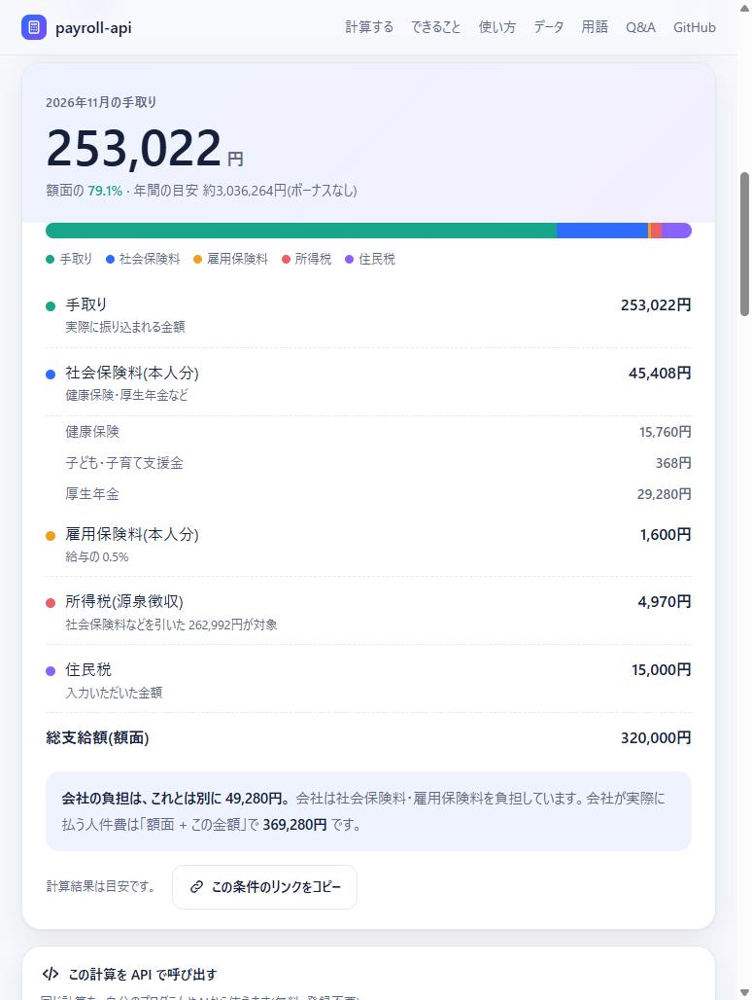
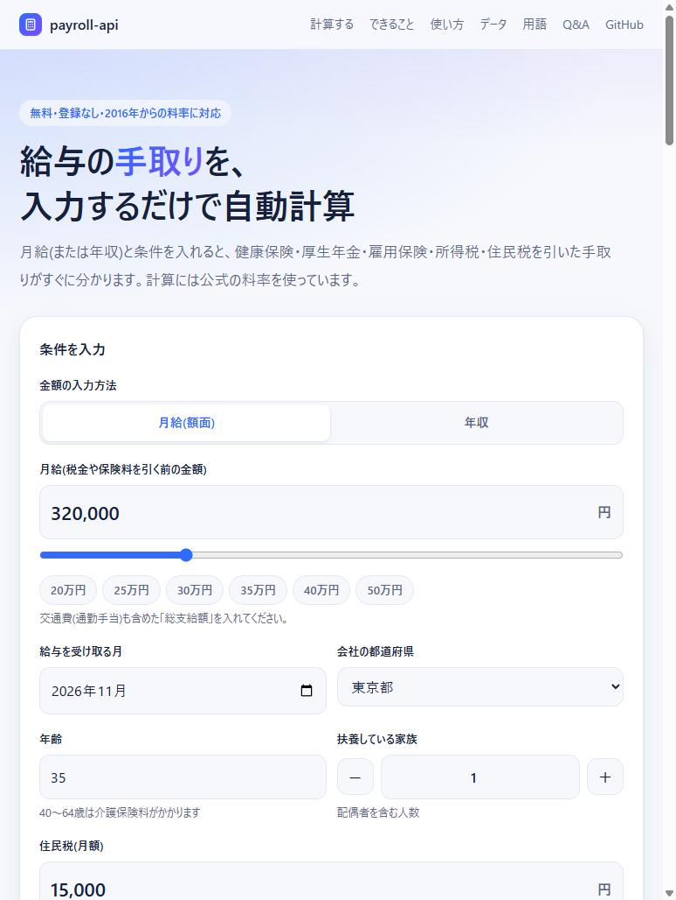

# payroll-api

給与から引かれる **社会保険料・雇用保険料・源泉所得税** の「率」と「計算」を、API と MCP で提供するサービスです。2016年からの履歴に対応し、公式サイトとの照合(改定検知)も自動で行います。

<p align="center">
  <a href="https://paps-jp.github.io/payroll-api/"></a>
  <a href="https://paps-jp.github.io/payroll-api/"></a>
</p>

<p align="center"><b><a href="https://paps-jp.github.io/payroll-api/">👉 手取り電卓 / 解説ページを開く</a></b></p>

- 🧮 **電卓 / 解説ページ**: https://paps-jp.github.io/payroll-api/ (月給・年収を入れるだけで手取りを自動計算。使い方・用語解説・Q&A つき)
- 🔌 **API**: https://payroll-api.paps.jp (無料・登録不要・トークン不要)
- 🤖 **MCP**: https://payroll-api.paps.jp/mcp (AI アシスタントから直接呼び出し)

Go 製・外部依存なし(標準ライブラリのみ)。

## できること

| 機能 | 内容 |
|---|---|
| 料率の参照 | 指定した月に適用される料率 (健保・介護・厚年・子ども子育て支援金/拠出金・雇用保険) |
| 社会保険料の計算 | 標準報酬月額の等級判定、本人/事業主の負担額 (端数処理つき) |
| 雇用保険料の計算 | 一般 / 農林水産・清酒製造 / 建設、期中改定にも対応 |
| 源泉所得税の計算 | 月額表 甲欄 (電算機計算の特例) と乙欄、復興特別所得税込み |
| 手取りの一括計算 | 上記 + 住民税 (通知額を入力) から、手取りと会社負担を計算 |
| 改定検知 | 協会けんぽ・厚労省・国税庁の公開状況をデータと照合 |

## クイックスタート

```bash
# 2026年5月・東京都・月給32万円・35歳・扶養1人・住民税1万5千円 → 手取りまで
curl "https://payroll-api.paps.jp/v1/calc/payroll?month=2026-05&prefecture=東京都&gross=320000&age=35&dependents=1&non_taxable_commute=10000&resident_tax=15000"
```

主な結果: 手取り **253,022円** (社会保険料 45,408 / 雇用保険料 1,600 / 所得税 4,970 / 住民税 15,000)、会社負担 49,280円。

### REST API

月は `YYYY-MM` (給与の支払月・対象月)。**2016年より前の月はデータなし**でエラーになります。

| パス | 内容 |
|---|---|
| `GET /v1/meta` | 都道府県一覧・対応開始月・事業区分 (入力フォーム用) |
| `GET /v1/rates?month=&prefecture=` | 指定月の適用料率 (`prefecture` 省略で全47都道府県) |
| `GET /v1/revisions` | 登録済みの全改定 (種別・適用開始月・出典・検証済みか) |
| `GET /v1/grades` | 標準報酬月額の等級表 |
| `GET /v1/calc/social?month=&prefecture=&monthly_remuneration=` または `standard_remuneration=` `&age=` | 健康保険・介護保険・厚生年金・子ども子育て支援金/拠出金 |
| `GET /v1/calc/employment?month=&wage=&industry=general\|agri\|construction` | 雇用保険 |
| `GET /v1/calc/withholding?month=&amount=&column=ko\|otsu&dependents=` | 源泉所得税。`amount` = 社会保険料等控除後の給与額 |
| `GET /v1/calc/payroll?month=&prefecture=&gross=&age=&non_taxable_commute=&dependents=&column=&resident_tax=&industry=` | 控除と手取り・会社負担を一括計算 |

### MCP

AI アシスタントから使えます (HTTP POST の JSON-RPC)。

```bash
# Claude Code
claude mcp add --transport http payroll-api https://payroll-api.paps.jp/mcp
```

ローカルバイナリ (stdio) で使う場合 (Claude Desktop など):

```json
{ "mcpServers": { "payroll-api": { "command": "/path/to/payroll-api", "args": ["-stdio"] } } }
```

ツール: `get_rates` / `list_revisions` / `get_standard_remuneration_grade` / `calculate_social_insurance` / `calculate_employment_insurance` / `calculate_withholding_tax` / `calculate_payroll_deductions` / `check_for_revisions`

### 利用制限 (トークン不要の公開API)

- CORS は全オリジンに許可 (認証情報を扱わない読み取り専用)。**入力値は保存しません。**
- **IP ごとに毎分 120 回まで**。超えた分は `429` (`Retry-After` 付き)。10 分間に 5 回超過を繰り返すと **15 分間ブロック**。
- MCP の `check_for_revisions` は公式サイトを見に行くため、結果を 1 時間キャッシュします。
- トークン必須に戻す場合は `RATES_API_TOKEN` (または `-token`) を設定すると、`/v1/*` と `/mcp` が Bearer 必須になります。
- 制限値は `-rate`、実装は [`internal/guard`](internal/guard)。クライアント IP は前段の Caddy が付ける `X-Forwarded-For` を信頼します。

## 収録データ (2016年〜)

正本は [`internal/rates/rates.json`](internal/rates/rates.json) です。適用開始月ごとに版を持ち、すべての版に出典 URL と `verified` フラグがあります。

| 種別 | 収録 | 出典 |
|---|---|---|
| 健康保険・介護保険 (協会けんぽ) | 2016-03〜 (47 都道府県) | 協会けんぽ 各年度ページ |
| 厚生年金 | 2015-09〜 (17.828 → 2016-09 18.182 → 2017-09 18.3) | 日本年金機構 |
| 子ども・子育て支援金 | 2026-04〜 (0.23%) | 協会けんぽ |
| 子ども・子育て拠出金 | 2015-04〜 | 日本年金機構 |
| 雇用保険 | 2015-04〜 (期中改定を含む) | 厚生労働省 / 労働局リーフレット |
| 源泉所得税 | 2016 年分〜 (年ごとに版) | 国税庁『源泉徴収のあらまし』 (2016〜2018 年分は国会図書館 WARP の保存版) |

### 検証状況

- **源泉所得税**: 『あらまし』『税額表』に載っている計算例・税額表の値 **240 件**を [`testdata/withholding_examples.json`](internal/rates/testdata/withholding_examples.json) に置き、全年分を `go test` で再現しています。
- **健保 / 雇用保険**: 令和 8 年度は公式ページ・PDF と全件一致を確認。過去分は隣接年度ページとのクロスチェック済み。
- **確認が弱い項目** (`verified:false`): 標準報酬月額の**等級表の境界額**、**平成 28 年度 (2016-03) の健保料率** (出典 1 つ)、**拠出金率の 2015-04 / 2016-04** (間接的な出典)。計算結果の `unverified_rate_kinds` に出ます。
- **乙欄の注意**: 令和 2〜7 年分の乙欄は、国税庁の算式が月額表 (税額表) と約 29 万〜43.7 万円付近の一部の行で最大数千円ずれます (算式のほうが大きい)。本 API は算式どおりです。令和 8 年分は全行一致。

## 計算の仕様

- **端数処理**: 本人負担 = 50 銭以下切捨て・50 銭超切上げ / 事業主負担 = 総額 (四捨五入) − 本人負担。
- **年齢**: 介護保険は 40 歳以上 65 歳未満。75 歳以上は健康保険なし、70 歳以上は厚生年金・拠出金なし。
- **厚生年金の標準報酬**: 健康保険の標準報酬を 88,000〜650,000 円に収めて算出。
- **源泉所得税**: 甲欄は「電算機計算の特例」、乙欄は電算機計算の算式。税額表の値とは差が出ることがあり、年末調整で精算されます。
- **住民税**: 自治体の特別徴収通知額を `resident_tax` で受け取ります (計算しません)。

### 対象外

協会けんぽ管掌のみ (組合健保・共済は対象外)。賞与、随時改定、産休・育休の免除、労災保険、年末調整、日額表は未対応。**計算結果は目安**です。実務では最新の公式資料で確認してください。

## 改定への追従

料率が改定されたら、`rates.json` の該当配列に**新しい版を追記**します (過去の版は消さない。`effective_from` は `YYYY-MM`)。

1. 公式の公表値を確認 (`/v1/revisions` の `source`)
2. `rates.json` に版を追記し、確認できたら `verified: true`
3. `go test ./...`

`ratecheck` が公式の公開状況を確認し、データとの相違や未登録の改定を検知します。

```bash
go run ./cmd/ratecheck [-state .ratecheck-state] [-webhook https://hooks.slack.com/...]   # 要確認があれば終了コード 1
```

- 協会けんぽの `rate_prefectures/rNN` (今年度・来年度) を取得し、47 都道府県と介護保険料率を照合
- 厚労省「雇用保険料率について」ページの変化と、次年度の記載有無を検知
- 国税庁の次年分「電算機計算の特例」PDF の公開を検知 (nta.go.jp は存在しない URL でも HTTP 200 のエラーページを返すため、Content-Type で判定)
- GitHub Actions ([`ratecheck.yml`](.github/workflows/ratecheck.yml)) が**毎週月曜**に実行し、要確認があれば Issue を作成

## 開発・運用

```bash
go test ./...                                  # 全テスト (源泉所得税の計算例 240 件を含む)
go run ./cmd/server -addr 127.0.0.1:8080       # REST /v1/* と MCP /mcp  (-rate 120, -token SECRET)
go run ./cmd/server -stdio                     # MCP (stdio)
docker compose up -d --build                   # コンテナ (read-only, 非 root)。前段のリバースプロキシで TLS 終端
```

```
cmd/server        REST + MCP サーバー
cmd/ratecheck     改定検知 CLI
internal/rates    料率データ (rates.json) と計算ロジック (社保・雇用保険・源泉所得税・手取り)
internal/api      REST ハンドラ
internal/mcp      MCP (JSON-RPC 2.0, stdio / HTTP) の自前実装
internal/check    公式ページとの照合
internal/guard    CORS・IP 別レート制限・一時ブロック
docs/             GitHub Pages (電卓・解説)
```

## 関連サイト

- [ぱっぷすラボ](https://paps-jp.github.io/)
- [ぱっぷす ホームページ](https://www.paps.jp)
